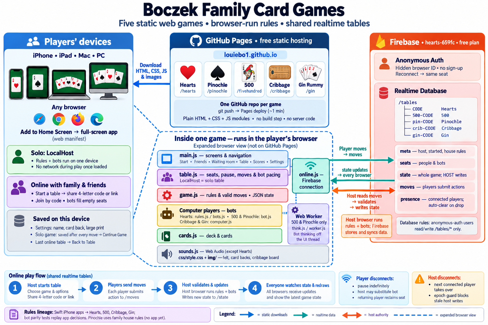

# Boczek Family Card Games — How They Work

Written 2026-10-27. Louie made the diagram above in ChatGPT from the description and
prompt below. If the design changes, update the description and prompt, and ask Louie
to remake the image — never generate it through an API.

## The prompt

> Draw a clean, colorful architecture diagram from the description below. Landscape layout. Put the players' devices on the left, GitHub Pages in the middle, and Firebase on the right. Inside one game, show the JavaScript modules as boxes stacked in layers. Use arrows labeled with what flows along them. Use friendly rounded boxes, a small icon for each game (♥ Hearts, ♠ Pinochle, 🃏 500, a cribbage board, Gin), and a short legend. Keep all text readable.

## 1. Hosting
- **Home page**: https://louiebo1.github.io/ (this repo) — one static page with a tile per
  game: Hearts, Pinochle, 500, Cribbage, Gin Rummy.
- **Each game is its own site**: louiebo1.github.io/hearts, /pinochle, /fivehundred,
  /cribbage, /gin — each in its own GitHub repo (`~/code/*-web`), served by **GitHub
  Pages** (free static hosting). Deploying = `git push`; Pages rebuilds in about a minute.
- **No server code, no build step**: plain HTML, CSS and JavaScript modules, downloaded
  straight to the browser. "Add to Home Screen" opens a game full screen like an app.

## 2. Players
- Any browser — iPhone, iPad, Mac, PC.
- **Against the computer**: everything runs on this one device.
- **With family and friends anywhere**: one person starts a table and gets a 4-letter
  code to share; others join with it; computer players fill empty seats.

## 3. Inside every game (the same layers in all five)
- `cards.js` — the deck and cards.
- `game.js` — the full rules of that game; the game state is plain data (JSON); illegal
  moves are rejected.
- **Computer players** — `rules.js`/`bots.js` (Hearts), `bot.js` (500, Pinochle),
  `computer.js` (Cribbage, Gin). Ported from the family's iPhone apps and checked to make
  the same decisions. In 500 and Pinochle they think in a background **Web Worker**
  (`think.js` / `worker.js`) so the screen never freezes.
- `table.js` — seats, pausing, applying moves, pacing the computer players; `LocalHost`
  runs a game against the computer.
- `online.js` — the connection to Firebase for online play.
- `main.js` — the screens: start, friends (start/join), waiting room with code and share
  link, the table, score sheet, settings.
- `sounds.js` — card sounds made in the browser with Web Audio (not in Hearts yet).
- `css/style.css`, `img/` — felt, card backs, the cribbage board.
- **Saved on the device** (browser localStorage): settings (name, card back, large
  print), the game against the computer after every move ("Continue Game"), and the last
  online table ("Back to Table").

## 4. Online play — one shared Firebase project (`hearts-659fc`, free Spark plan)
- **Anonymous Auth** — each browser gets a hidden ID, no sign-up; the same browser gets
  its seat back if it reconnects.
- **Realtime Database** — one tree, `/tables`, shared by all five games, each with its
  own code prefix: `/tables/CODE` (Hearts), `500-CODE`, `pin-CODE`, `crib-CODE`,
  `gin-CODE`. A table holds:
  - `meta` — who the host is, whether it's started, house rules (Pinochle)
  - `seats` — who sits where (person or computer)
  - `state` — the whole game; **only the host writes it**
  - `moves` — players push their moves here
  - `presence` — who is connected (cleared automatically when a browser drops)
- **Database rules** (`hearts-web/database.rules.json`): signed-in (anonymous) users may
  read and write `/tables/*`, nothing else.

## 5. How an online game runs (the "host" pattern)
1. Whoever starts the table is the **host**; their browser runs the rules and the
   computer players.
2. Other players' browsers send moves to `moves`.
3. The host checks each move, updates the game, and writes the new `state`.
4. Every browser watches `state` and redraws the table.
5. **A player drops**: the game pauses (no time limit); the host may "let a bot play for
   them"; the person gets the seat back on returning.
6. **The host drops**: the next connected player takes over hosting; an "epoch" guard
   stops the old host overwriting the game.

## 6. Where the rules come from
- Ported from the family's Swift iPhone apps (Hearts, 500, Cribbage, Gin Rummy); a
  parity test replays the apps' decisions to prove the web computer players match.
- Pinochle has no app yet — its rules are the family's house rules.
